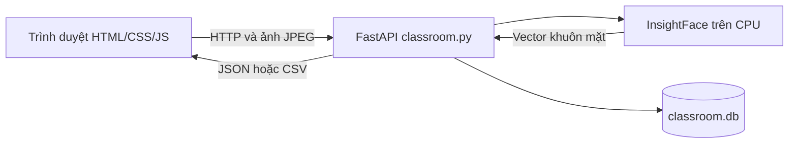

# Hệ thống điểm danh bằng nhận diện khuôn mặt

Ứng dụng local có giao diện tiếng Việt: tạo lớp, đăng ký học sinh bằng ảnh khuôn mặt, điểm danh qua webcam, xem lịch sử và xuất CSV. Backend dùng FastAPI, InsightFace, OpenCV và SQLite; frontend dùng HTML/CSS/JavaScript thuần, không cần npm hay bước build.

Đây là phiên bản phục vụ học tập và chạy thử. Đã có đăng nhập giảng viên và phân quyền lớp môn học; chưa có kiểm tra người thật trước camera.

## Tài liệu

- Hướng dẫn thao tác và lịch học: xem các phần bên dưới.
- [Thí nghiệm SVM và cosine mới nhất](trainning/README.md).
- [Bản Word giải thích dự án](docs/TAI-LIEU-DU-AN-DIEM-DANH.docx): cập nhật ngày 29/10/2026, đã gồm thí nghiệm SVM và cosine ở phần 16.
- [Giải thích chi tiết code, kiến trúc và thuật toán](docs/GIAI-THICH-CODE-VA-THUAT-TOAN.md): luồng dữ liệu, từng module, công thức, ví dụ và giới hạn.

## 1. Chức năng hiện có

| Chức năng | Cách hoạt động |
|---|---|
| Lớp học | Tạo lớp với tên, môn học và giáo viên; chọn lớp làm việc |
| Học sinh | Chụp một ảnh webcam hoặc tải 1–5 ảnh để đăng ký khuôn mặt |
| Điểm danh | Bấm **Chụp & điểm danh**, so khớp trong lớp đang chọn |
| Chống trùng | Một bản ghi/học sinh/buổi học theo giờ UTC+7 |
| Tra cứu | Chọn ngày, tìm theo tên/mã, lọc có mặt/chưa điểm danh |
| Thống kê | Tổng học sinh, số có mặt, chưa điểm danh và tỷ lệ có mặt |
| Xuất CSV | Tải danh sách ngày chọn, có hỗ trợ dấu tiếng Việt |

Camera không tự quét liên tục. “Chưa điểm danh” không tự động có nghĩa là vắng học. Đã có nhiều buổi trong một ngày; chưa có sửa/xóa lớp và học sinh trên giao diện.

## 2. Khởi động trên Windows

Thực hiện trong PowerShell. Môi trường được cố định theo Python 3.11; Node.js 22 chỉ cần cho kiểm tra JavaScript. GitHub Actions tự chạy backend, evaluation và frontend tests khi push lên `main`, tạo pull request hoặc chạy thủ công.

Nếu đã có `.venv` và thư viện:

```powershell
cd D:\SIC\Facial-Recognition-Attendance-System
powershell -ExecutionPolicy Bypass -File .\start.ps1
```

Nếu cài từ đầu:

```powershell
cd D:\SIC\Facial-Recognition-Attendance-System
python -m venv .venv
.\.venv\Scripts\python.exe -m pip install -r .\backend\requirements.txt
powershell -ExecutionPolicy Bypass -File .\start.ps1
```

Thay đường dẫn nếu lưu dự án ở nơi khác. `start.ps1` chuyển thư mục làm việc vào `backend`, gọi Python trong `.venv`, chạy Uvicorn ở `127.0.0.1:8000`. Script không tự tạo môi trường hay cài thư viện.

- [Giao diện](http://127.0.0.1:8000)
- [Swagger API](http://127.0.0.1:8000/docs)
- [Health check](http://127.0.0.1:8000/health)

Nhấn `Ctrl+C` ở terminal để dừng server. Nếu server đã chạy thì chỉ cần mở trang.

Model được cấu hình lưu dưới `.insightface` ở gốc dự án. Khi chưa có model, InsightFace tải model khi lần đầu cần nhận diện; bước này cần mạng. Code chọn `CPUExecutionProvider`, không yêu cầu GPU. Các thư viện backend được ghim phiên bản trong `backend/requirements.txt`; CI mock việc khởi tạo model và không tải model khuôn mặt.

### Deploy lên AWS EC2 qua GitHub Actions

Workflow CD nằm ở `.github/workflows/cd-aws.yml`. Sau khi workflow `CI` chạy thành công trên `main`, CD build Docker image trên GitHub runner, truyền image qua SSH tới EC2, cập nhật `/opt/sic` và chạy Compose với `compose.ec2.yaml`. Ở lần chuyển đầu, CD sao chép `backend/classroom.db` và model cache nếu có vào Docker volumes, sau đó tắt `sic.service` và khởi động container. Các lần deploy sau cập nhật container mà giữ nguyên volumes. Image không cần registry riêng và không build trên EC2. Có thể chạy thủ công từ tab Actions khi chọn nhánh `main`.

Trước khi bật deploy, cấu hình các Actions secrets trong GitHub repository → **Settings → Secrets and variables → Actions**:

| Secret | Giá trị |
|---|---|
| `EC2_HOST` | Public DNS hoặc Elastic IP của EC2 |
| `EC2_USER` | `ubuntu` cho Ubuntu AMI |
| `EC2_SSH_PRIVATE_KEY` | Toàn bộ nội dung khóa riêng PEM; không commit vào repository |
| `EC2_KNOWN_HOSTS` | Dòng host key đã xác minh của EC2 để SSH kiểm tra danh tính máy chủ |

EC2 cần Docker Engine, Docker Compose v2, Nginx, systemd service `sic` (dùng làm phương án quay lui), và cho phép SSH từ GitHub runner. Compose chỉ bind cổng 8000 trên loopback; Nginx tiếp tục nhận HTTPS và proxy tới ứng dụng. Sau lần chuyển đầu, thao tác tài khoản từ terminal nên chạy trong container để dùng đúng database volume, ví dụ `sudo docker compose -p sic -f compose.yaml -f compose.ec2.yaml exec sic python manage_teachers.py list`.

### Chạy bằng Docker Compose

Docker đóng gói FastAPI, giao diện và các thư viện nhận diện trong image nhiều tầng; compiler chỉ có trong giai đoạn build. Ứng dụng chạy bằng user không phải root, filesystem gốc chỉ đọc, và quyền Linux dư thừa được gỡ bỏ. SQLite và model InsightFace được giữ ở hai Docker volume riêng để không mất dữ liệu khi cập nhật hoặc tạo lại container. Lần đầu nhận diện có thể tải model xuống và cần kết nối mạng.

Yêu cầu Docker Engine với Docker Compose v2 (hoặc Docker Desktop trên Windows). Từ thư mục gốc dự án:

```sh
docker compose up -d --build
docker compose ps
```

Mở `http://localhost:8000`. Xem nhật ký bằng `docker compose logs -f sic`; dừng bằng `docker compose down`. Lệnh `down` giữ nguyên dữ liệu; **không** thêm `-v` nếu muốn giữ database và model. Muốn đổi cổng máy host, tạo file `.env` với `SIC_PORT=8080`, rồi mở `http://localhost:8080`. Compose chỉ bind cổng trên loopback của máy host.

Khi chạy container sau Nginx/HTTPS, đặt `AUTH_COOKIE_SECURE=1`; cấu hình EC2 override đã bật tùy chọn này. `t3.micro` chỉ có 1 GiB RAM; CD build image trên GitHub runner để tránh build tốn RAM trên instance. Nhận diện InsightFace vẫn cần RAM khi chạy; theo dõi bộ nhớ EC2 sau khi bật nhận diện.

## 3. Sử dụng lần đầu

1. Vào **Lớp học**, tạo lớp với môn học và giáo viên.
2. Vào **Học sinh**, chọn **Thêm học sinh**, nhập tên và mã duy nhất trong mỗi lớp môn học.
3. Chụp trực tiếp một ảnh hoặc tải 1–5 ảnh. Mỗi ảnh tối đa 10 MiB. Ảnh tải lên phải có đúng một khuôn mặt; webcam yêu cầu đúng một mặt hợp lệ trong oval, bỏ qua người ngoài oval.
4. Bấm **Thêm & đăng ký khuôn mặt**. Backend tạo vector ngay; học sinh không cần chạy `generate_embeddings.py`.
5. Vào **Điểm danh**, chọn lớp và buổi học, mở điểm danh trong giờ hợp lệ, bật camera rồi bấm **Chụp & điểm danh**.
6. Vào **Lịch sử điểm danh** để chọn ngày hoặc **Xuất CSV**.

## 4. Kiến trúc



Ứng dụng hiện chỉ giữ luồng lớp học `/api/...`. Dữ liệu lớp, học sinh, vector khuôn mặt và lịch sử nằm trong `backend/classroom.db`. Ảnh đăng ký được xử lý để tạo vector, không lưu vào dataset. Phần API và module nhân viên cũ đã được gỡ bỏ.

## 5. Cấu trúc mã nguồn

```text
Facial-Recognition-Attendance-System/
├── README.md
├── docs/GIAI-THICH-CODE-VA-THUAT-TOAN.md
├── start.ps1
├── frontend/
│   ├── index.html              # Trang và các form
│   ├── styles.css              # Giao diện responsive
│   └── app.js                  # State, gọi API, camera, render
├── backend/
│   ├── app.py                  # FastAPI và static frontend
│   ├── classroom.py            # Nghiệp vụ lớp học
│   ├── face_engine.py          # Khởi tạo mô hình AI dùng chung
│   ├── test_classroom.py       # Kiểm tra nghiệp vụ
│   └── requirements.txt
└── tests/enrollment.test.cjs    # Kiểm tra đăng ký qua camera
```

`.venv`, `.insightface`, database, dataset và embeddings là môi trường/dữ liệu chạy; không phải đều có sẵn trong bản mã nguồn mới.

## 6. Thuật toán tóm tắt

1. OpenCV giải mã ảnh; ảnh có cạnh lớn hơn 1600 pixel được thu nhỏ giữ tỷ lệ.
2. InsightFace phát hiện khuôn mặt và tạo embedding — vector số biểu diễn đặc trưng. Webcam chọn đúng một khuôn mặt hợp lệ trong oval; ảnh đăng ký tải lên yêu cầu đúng một khuôn mặt toàn ảnh.
3. Chuẩn hóa vector về độ dài 1. Đăng ký nhiều ảnh: kiểm tra tương đồng với ảnh đầu, lấy trung bình và chuẩn hóa lại.
4. Khi điểm danh, tính tích vô hướng với vector từng học sinh trong lớp. Vì các vector đã chuẩn hóa, đây là cosine similarity.
5. Chọn điểm cao nhất: **≥ 0,70** thì ghi điểm danh, thấp hơn trả `unknown`.
6. SQLite chống trùng theo cặp buổi học và học sinh trong `session_attendance`; dữ liệu lịch sử ngày cũ được giữ riêng.

`0,70` là ngưỡng so khớp, **không phải xác suất đúng 70%**. Thêm học sinh chỉ lưu vector mẫu từ mô hình đã huấn luyện sẵn, không huấn luyện lại AI. Xem [giải thích công thức và code](docs/GIAI-THICH-CODE-VA-THUAT-TOAN.md).

## 7. API lớp học

| Method | Đường dẫn | Đầu vào/kết quả |
|---|---|---|
| GET | `/api/classes` | Danh sách lớp, số học sinh, ngày UTC+7 |
| POST | `/api/classes` | JSON `name`, `subject`, `teacher`; trả ID |
| GET | `/api/classes/{class_id}/roster?day=YYYY-MM-DD` | Danh sách và trạng thái theo ngày |
| POST | `/api/students` | Multipart `class_id`, `name`, `code`, các `images` |
| POST | `/api/classes/{class_id}/recognize` | Multipart `image`; trả `success`, `duplicate`, `unknown` |
| GET | `/api/classes/{class_id}/export?day=YYYY-MM-DD` | Tải CSV |

Bỏ `day` thì dùng ngày hiện tại. Lỗi nghiệp vụ thường trả 400, không tìm thấy 404, trùng dữ liệu 409; lỗi schema có thể trả 422. `unknown` và `duplicate` là trạng thái nghiệp vụ trong phản hồi HTTP thành công.

## 8. Kiểm tra

Từ thư mục gốc dự án:

```powershell
 $env:PYTHONPATH = ".;backend;evaluation"
 .\.venv\Scripts\python.exe -m unittest discover -s backend -p "test_*.py" -v
 .\.venv\Scripts\python.exe -m unittest discover -s evaluation -p "test_*.py" -v
node --test .\tests\enrollment.test.cjs .\tests\attendance-guide.test.cjs
```

Các bài backend/evaluation dùng database tạm và vector giả; frontend dùng DOM/camera giả lập. Chúng kiểm tra logic, không đo độ chính xác trên người thật. Unit test không cần tải model InsightFace.

## 9. Lỗi thường gặp

| Hiện tượng | Kiểm tra |
|---|---|
| Không tìm thấy Python trong `.venv` | Tạo môi trường và cài requirements theo phần 2 |
| Cổng 8000 đã được dùng | Kiểm tra server đang chạy trước khi mở thêm |
| Khởi động lâu/lỗi model | Xem terminal, mạng và thư mục `.insightface` |
| Không mở camera | Cấp quyền, đóng ứng dụng đang dùng webcam, dùng địa chỉ local ở trên |
| Ảnh bị từ chối | Kiểm tra dung lượng, file đọc được, đúng một khuôn mặt |
| Không nhận ra học sinh | Kiểm tra lớp, ánh sáng, góc chụp và ảnh đăng ký |

## 10. Giới hạn và dữ liệu

Chưa có xác thực, liveness/anti-spoofing, mã hóa embedding hoặc sao lưu tự động. Ảnh chụp lại từ màn hình có thể được nhận diện do chưa kiểm tra người thật. Không coi kiểm thử nghiệp vụ là chứng nhận độ chính xác hoặc khả năng triển khai công khai.

Để sao lưu lớp học, dừng server rồi sao chép `backend/classroom.db`. Embedding vẫn là dữ liệu sinh trắc học dù không lưu ảnh gốc.

## Nguồn gốc

Phát triển từ **AI Powered Facial Recognition Attendance System using FastAPI and InsightFace**; địa chỉ ghi trong README gốc: [Vishal7-hub/Facial-Recognition-Attendance-System](https://github.com/Vishal7-hub/Facial-Recognition-Attendance-System). Tài liệu này mô tả code hiện có trong workspace, bao gồm phần lớp học và giao diện được bổ sung.

## Đánh giá AI offline

Bộ công cụ trong [evaluation](evaluation/README.md) dùng ảnh kiểm thử riêng để đo nhận đúng, nhận nhầm, so sánh ngưỡng và thời gian xử lý. Không thay đổi luồng điểm danh hay ngưỡng đang chạy. Chạy đánh giá khi không có người điểm danh để tránh dùng chung CPU.

## Buổi học

Tạo buổi theo lớp, ngày và giờ, mở/đóng điểm danh, xem danh sách và xuất CSV theo buổi. Điểm danh yêu cầu session_id; bảng session_attendance chống trùng theo buổi/học sinh. Lịch sử ngày cũ được giữ nguyên. Xem phần hướng dẫn buổi học bên dưới để thao tác. Các route mới: GET/POST /api/classes/{class_id}/sessions, PATCH /api/classes/{class_id}/sessions/{session_id}. Roster, export và recognize nhận query session_id.


## Điểm danh theo buổi học

1. Chọn lớp tại trang Điểm danh, bấm **Tạo buổi học**.
2. Nhập tên buổi, ngày, giờ bắt đầu và kết thúc (giờ Việt Nam). Buổi không kéo qua nửa đêm; giờ kết thúc phải sau giờ bắt đầu.
3. Buổi mới mặc định đóng. Chọn buổi rồi bấm **Mở điểm danh**. Camera chỉ cho điểm danh trong đúng ngày và khoảng giờ đã đặt (không bao gồm thời điểm kết thúc).
4. Bật camera và chụp. Một học sinh chỉ có một bản ghi mỗi buổi nhưng có thể điểm danh buổi khác trong cùng ngày.
5. Bấm **Đóng điểm danh** khi kết thúc. Có thể mở lại; bản ghi cũ không mất và vẫn chống trùng. Hết giờ thì backend tự từ chối dù trạng thái vẫn ghi đang mở; không có tác vụ tự đổi trạng thái.
6. Trong **Lịch sử điểm danh**, chọn ngày rồi chọn buổi để xem và xuất CSV. Có thể chọn ngày tương lai để xem/mở trạng thái buổi đã lên lịch, nhưng chưa thể ghi điểm danh trước giờ.
7. **Tổng hợp ngày / dữ liệu cũ** giữ lịch sử trước khi thêm tính năng buổi học; dữ liệu cũ không tự gán vào buổi mới. Dashboard đếm mỗi học sinh tối đa một lần trong ngày, không cộng lặp các buổi.

Nút **Làm mới** cập nhật trạng thái buổi và ngày hiện tại, hữu ích khi đến giờ bắt đầu hoặc có người thao tác ở tab khác. Buổi mới không cần chạy lại hay huấn luyện AI. Bản sao SQLite trước cập nhật nằm trong `backend/backups/`.

## Lịch học cố định

Trong **Tạo buổi học**, nhập tên và giờ, chọn ngày bắt đầu và các thứ trong mục **Lặp lại hàng tuần**. Có thể đặt ngày kết thúc; không chọn thứ nghĩa là tạo một buổi riêng như trước.

Lịch lưu trong SQLite. Vào ngày khớp lịch, khi mở lớp ở trang Điểm danh hoặc bấm **Làm mới**, hệ thống tạo buổi hôm nay ở trạng thái đóng. Bấm **Mở điểm danh** để sử dụng. Không cần giữ server chạy qua nửa đêm; không có tác vụ nền và không tự tạo bù các ngày đã qua.

**Lịch cố định → Dừng lịch** ngừng tạo các buổi mới, giữ nguyên buổi đã tạo và kết quả. Muốn đổi lịch, dừng lịch cũ và tạo lịch mới với tên khác. Nếu đã có buổi cùng tên trong ngày, hệ thống giữ buổi hiện có thay vì tạo trùng hay ghi đè giờ. Lịch không làm tăng số lần suy luận AI.


## Thí nghiệm huấn luyện SVM (29/10/2026)

Web vẫn dùng cosine. Thư mục `trainning/` chứa quy trình LFW → embedding InsightFace → train LinearSVC → chọn cấu hình/ngưỡng trên validation → so sánh test. Xem [hướng dẫn và giới hạn kết quả](trainning/README.md). Phần này không ghi vào database hay thay đổi nhận diện của web.


## Admin giảng viên và ghi danh lớp môn học

Cập nhật 31/10/2026: lớp môn học là một nhóm học phần, ví dụ Giải tích 2 · Nhóm 01, không phải lớp hành chính như 68PM2. Sinh viên từ bất kỳ lớp hành chính nào đều có thể ghi danh cùng lớp môn học. Một lớp môn học hiện được giao cho một giảng viên.

- Admin xem toàn hệ thống; tạo/sửa tên lớp, môn và giảng viên phụ trách; tạo buổi học và quản lý lịch cố định; tạo hồ sơ khuôn mặt sinh viên; ghi danh sinh viên đã có hồ sơ vào nhiều môn.
- Giảng viên xem tổng quan, danh sách và lịch sử của lớp được giao; chọn buổi do admin xếp lịch, mở đóng điểm danh, nhận diện và xuất CSV. Không được tạo/sửa lớp, tạo buổi/lịch học, dừng lịch cố định, tạo hồ sơ hoặc ghi danh sinh viên, kể cả gọi API trực tiếp.
- students là danh mục sinh viên dùng chung, mã sinh viên duy nhất. enrollments nối sinh viên với lớp môn học và ngày ghi danh. Không cần chụp lại ảnh khi thêm sinh viên vào môn khác.
- Lịch sử ngày được tính theo sinh viên, lớp môn học và ngày; điểm danh buổi theo sinh viên và buổi. Có mặt ở môn A không làm có mặt ở môn B. Không hiển thị sinh viên trong lịch sử trước ngày ghi danh.
- Dashboard cộng lượt ghi danh của các lớp trong phạm vi được xem, không phải số người duy nhất toàn trường.

### Dữ liệu mẫu trên máy hiện tại

| Vai trò | Tài khoản | Lớp môn học |
|---|---|---|
| Admin | admin.samsung | Tất cả lớp |
| Giảng viên Lương Xuân Hiếu | hieulx.samsung | Giải tích 2 · Nhóm 01 |
| Giảng viên Dương Kim Thanh | thanhdk.samsung | Lập trình Python · Nhóm 01 |
| Giảng viên Vũ Thành Vinh | vinhvt.samsung | Cơ sở dữ liệu · Nhóm 01 |

Tên môn là dữ liệu mẫu và có thể sửa bằng admin. Mật khẩu được cấp riêng, không lưu rõ trong mã nguồn. Đổi mật khẩu mẫu trước khi triển khai công khai.

### Thao tác admin

Đăng nhập → Lớp môn học → Tạo lớp → chọn giảng viên. Nút Sửa lớp cho phép đổi tên, môn và người phụ trách mà giữ nguyên ID, ghi danh và lịch sử. Khi đổi giảng viên, quyền xem lịch sử lớp chuyển sang giảng viên mới.

Vào Sinh viên, chọn lớp môn học. Thêm sinh viên tạo hồ sơ mới và ghi danh vào lớp đang chọn. Ghi danh có sẵn cho phép tìm tên/mã trong danh mục dùng chung rồi thêm vào lớp, không sao chép hồ sơ hoặc embedding. Sinh viên đã ghi danh sẽ không xuất hiện trong danh sách chọn của lớp đó.

### Phiên đăng nhập và quản trị tài khoản

Phiên đăng nhập 8 giờ dùng cookie HttpOnly, SameSite Strict. HTTPS tự bật Secure; sau reverse proxy cần cấu hình scheme đúng hoặc đặt AUTH_COOKIE_SECURE=1. Đăng xuất và đặt lại mật khẩu thu hồi phiên server. Mật khẩu lưu bằng scrypt với salt ngẫu nhiên; token chỉ lưu hash. Giới hạn 10 lần thử trong 15 phút theo cặp IP và tên tài khoản.

Quản trị tài khoản tại máy chủ, không có đăng ký công khai:

```powershell
.\.venv\Scripts\python.exe .\backend\manage_teachers.py list
.\.venv\Scripts\python.exe .\backend\manage_teachers.py create --username gv.moi --name "Giảng viên mới" --role teacher
.\.venv\Scripts\python.exe .\backend\manage_teachers.py create --username admin.moi --name "Admin mới" --role admin
.\.venv\Scripts\python.exe .\backend\manage_teachers.py reset-password --username gv.moi
```

Công cụ hỏi mật khẩu trong terminal. Chỉ quản trị cục bộ mới cấp vai trò admin. Dữ liệu cũ được sao lưu trước khi chuyển đổi trong backend/backups/before-course-enrollments-*.db; ID hồ sơ và lịch sử được giữ. Nếu gặp các mã sinh viên trùng giữa hồ sơ cũ, migration dừng và rollback để kiểm tra, không tự ghép người có thể khác nhau.

Bản Word và tài liệu thuật toán trước bản cập nhật này chưa mô tả admin và enrollments; dùng mục này làm hướng dẫn vận hành hiện tại.


## Lịch dạy theo ngày và tuần

Mục Lịch dạy hiển thị ca sáng (trước 12h), chiều (12–18h), tối (từ 18h), có chọn ngày, tuần trước/sau và Hôm nay. Buổi kéo qua nhiều ca xuất hiện ở mỗi ca liên quan, tổng số buổi không cộng lặp. Giảng viên chỉ xem lịch của mình; admin xem tất cả, lọc theo giảng viên và tạo buổi bằng cách chọn lớp. Buổi hôm nay có nút chuyển sang điểm danh.

API GET /api/teaching-calendar dự phóng lịch lặp từ hôm nay trở đi, không ghi database khi xem lịch. Buổi đã tạo được ưu tiên theo lớp/ngày/tên giống cơ chế tạo buổi hiện có. Lịch cũ đã qua chỉ hiện buổi thực sự đã tạo. Nhãn trùng giờ là cảnh báo các buổi giao nhau của cùng giảng viên trong khoảng đang xem, chưa ngăn lưu lịch. Hiện chưa có dữ liệu phòng học, loại lý thuyết/thực hành hoặc số tiết nên không hiển thị các trường này.
